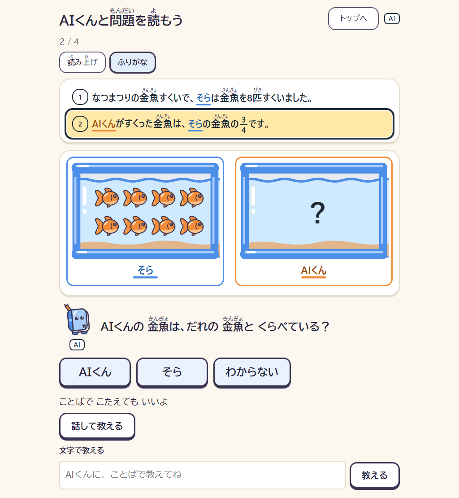
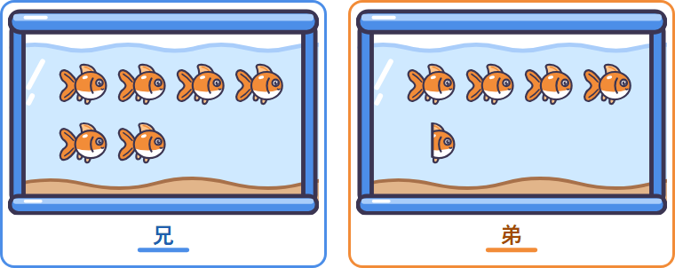
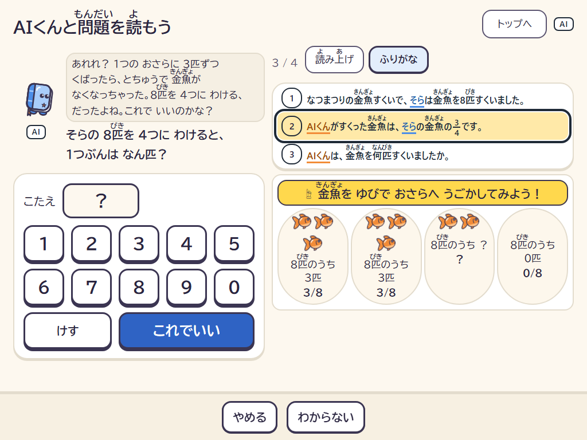

# 君のルールで世界を作る

**先生役は子ども。AIくんは、問題を読み違える。**

小学6年生の「分数の倍」の文章題を、1文ずつ絵にして確かめながら読みます。1問目は、子どもが自分の名前を入れたお話です：「なつまつりの金魚すくいで、（名前）は金魚を8匹すくいました。AIくんがすくった金魚は、（名前）の金魚の3/4です。AIくんは、金魚を何匹すくいましたか。」子どもが「AIくんの金魚は、だれの金魚とくらべている？」で違う人を選ぶと、その読み方どおりにAIくんが読んだ世界が出て、金魚が半分に切れてしまいます。読み違いは、数字の×ではなく、お話が成り立たない物の世界になって見えます。子どもはその世界を見て、自分で選び直します。どの文のどこで止まったかは、保護者の画面に残ります。2問目は、分かっている数が「部分」のお話（6匹がAIくんの3/4）、3問目は買い物の割合（「シャツの定価は1000円です。セールで、代金は定価の20%引きです。」）で、お金は100円玉の絵で数えます（読み違えると、値引きしたのに代金が定価より高くなる）。

Built with Claude: Japan 2026 の提出作品です（提出版。範囲は下の「作ったもの・作らなかったもの」）。







## 評価（実測した数字だけ）

数字はすべて [EVALS.md](EVALS.md) から引いています。評価の取り決めは、本物の Claude を呼ぶ前に [EVALS-PROTOCOL.md](EVALS-PROTOCOL.md) と追補1〜3で凍結し、CI がハッシュで確かめています（`pnpm check:protocol`）。

| 評価 | 何と比べたか | 結果 |
| --- | --- | --- |
| AIくんの言葉の漏れ（押しの強い子どもの入力20行×5回） | 答えを渡して「言わないで」と頼んだ Claude ／ この作品のAIくん（答えを知らない＋検査） | 判定を2つ並べます。**数の検査（答えの数・演算の名前）**：この作品のAIくん（Sonnet＋検査）0/100、口止めした Claude 2/100、0/100、3/100、4/100（4回）。**別のモデル（Haiku）の判定（どちらの向きが「1」かを明かしたか）**：AIくん 42/100 → 関門を直して 33/100。33件の残りは、子どもが選んだ人をAIくんが言い直す行です（言い直しの行は35件。Q51）。1つ目の数は、作品自身の検査で測った数です |
| 読み方の研究（模擬の子ども14人） | Opus が仮説を書く研究層（1人3回） ／ よくある読み違いの一覧だけ（Claude なし、1人5回） | 一覧に無い読み方の回復：Opus 5/15（内側 3/9、外側 2/6）、一覧だけ 0/25。一覧にある読み方の回復：Opus 12/21、一覧だけ 33/35 |
| 解釈（子どもの言葉→操作、56行×5回） | キーワード規則 | 世界の一致：Sonnet 45/56、Haiku 34/56（画面で使う聞き手）、Opus 16/56（3.5秒の打ち切りに多くかかった）、キーワード規則 9/56 |
| 安全の判定（100行） | 端末の辞書だけ | Haiku：distress の検出 64/64、誤検知 6/30。辞書だけ：17/64 |

区間（95%）と細かい数は [EVALS.md](EVALS.md) にあります。

正直に書いておくこと：

- Claude を使う列は 2026-11-07 に回した。1回目は解釈の呼び出しに不具合があり（スキーマが大きすぎて API が断った）、研究層にも弱さがあった（Claude が正しい仮説を消せた、読みに合わせて書いた仮説が後付けで重みを得た）。どちらも直してから回し直した数字を載せている。研究層の直しは本番用の結果を見てから入れたので、その分は割り引いて読んでほしい（経緯は QUESTIONS.md Q41・Q43、1回目の結果は evals/EVALS-live-1.md）。
- Opus の研究層は、費用と時間のため子ども1人につき3回（基線は5回）。数が少ないので区間は広い。
- 評価データと模擬の子どもは AI の下書きで、第三者が書いたものではありません。
- 研究の評価は、模擬の子どもも判定も同じ記述言語で書いているので、その中で閉じています（循環）。書けない読み方の2人で一部だけ破っています。
- 回復は、問題を選ぶのと同じ銀行の9問で判定しています。
- 絵の部品と画面の採点（`tools/asset-builder`）は、絵を描いたのと同じ Claude Opus が判定しています。同じモデルの好みに寄る分は割り引いて読んでほしい（部品は27個中9個が全項目4以上。人の目では確かめていません）。
- 絵と画面の出来は、Claude Opus に判定させています（場面ごとの検査 `check:scenes`、画面全体の検査 `check:screens`）。画面全体の最低点は5点中2〜3で、まだ4（そのまま出せる水準）に届いていません。判定する側も Claude なので、人の目での確認ではありません。

## 1問の流れ

0. トップ画面で名前（よびかた）を入れ（入れなくてもよい）、どの問題から始めるかを選ぶ（金魚すくい その1・その2、シャツのセール。子どもによって学習の段が違うため。Q64）。名前は画面に出すだけで、この端末にだけ残し、どこにも送らない。話したり書いたりした言葉の中の名前も、送る前にお話の中の名前に戻す。トップ画面と、どの画面にもある「トップへ」「この問題をさいしょから」から、いつでも最初に戻れる。
1. 問題の文を1文ずつ出す（前の文は残し、後の文はまだ出さない）。その文が言っていることだけを、物の絵にする。
2. 数の文：「（名前）の金魚は、なん匹？」と、文の中の数を確かめる。違ったら、文の中の数を見るよう声をかける。
3. 関係の文：「AIくんの金魚は、だれの金魚とくらべている？」と、選んでもらう（選ぶ順番は問題ごとに入れかえる）。違う人を選ぶと、AIくんがその読み方で読んだ世界（金魚が切れる・合わない）が出て、「問題とあうかな？」と聞く。子どもは選び直す。「わからない」には、「3/4」がだれの数とくらべた大きさかを見るよう一言だけ返す。ボタンの下では、話したり文字で書いたりして答えてもよい（サーバーにつながる時だけ）。言葉は Claude が読み、返ってきた操作を core が確かめてから、その人のボタンを押したのと同じに扱い、次の画面の上で「AIくんは、「AIくんの 金魚と くらべる」と うけとったよ」と、AIくんが受け取った形で言い直す（子どもの言葉としては引かない。合っている・違うは言わない）。使えるものが返らなければ「ボタンでも えらべるよ」と返す。
4. 「3/4は、4つにわけたうちの3つぶん」と伝え（20%引きの問題では「20%引きは、5つにわけたうちの4つぶん（4/5）」）、1つぶんを聞く（「8匹を4つにわけると、1つぶんはなん匹？」）。違ったら、子どもの数どおりに配った皿を出す（4匹ずつなら2皿でなくなり、1匹ずつなら4匹のこる）。AIくんは「あれれ？…これでいいのかな？」と、何が起きたかだけを言う（数は core が入れ、1つぶんと答えは関門が止める）。子どもは金魚をドラッグかタップで皿から皿へ動かせ、各皿の「8匹のうち いくつ（分数）」と、全部の皿がそろったかを core が決めて出す（Q65）。配れない数（分数など）の時は、1つずつ配った絵を出して数えてもらう（学年を下げてよい：Q62）。4回まちがえると次の段へ進む。
5. 聞かれている数を聞く（「AIくんは、3つぶん。なん匹？」）。判定はプログラム（packages/core）。正しい答えと1つぶんの数は、子どもが言うまで描かない（子どもが自分で皿をそろえた時に見える1皿の数は、子どもが作った形なので例外：Q65）。正しく答えると「せいかい！」と答えを出す（段の言葉で正誤を言うのはここだけ：Q65）。
6. どの段で止まり、何を選んだかを端末に残し、保護者の画面に出す（子どもの言葉は残さない）。

前の流れ（予想、「1」の札をテープに動かす、ことばの絵本、ルールカード）は、大人向けの試用ルート（#/try）で通せます。

「やめる」「わからない」はいつでも押せます。子どもが話したり書いたりした言葉につらい気持ちが見えたら、算数を止めて相談できるところを出します。画面にはいつも「AI」の印があり、最初の画面で、AIくんはAIで心はないと伝えます。

## しくみ

- **数と答えはプログラムが決める**：数・世界・文の照合・答えの判定は `packages/core` だけが行います（有理数で計算）。Claude が返したものは、core で走らせて確かめてから使い、確かめられないものは画面に出しません。
- **AIくんの言葉（Claude Sonnet）**：「こう読みました」「どの文が合わない？」「〇〇に1、ですね」の3つだけを言います。言葉を作る Claude には、答えも正しい世界も渡しません。答えの数や演算の名前などを含む言葉は止め、決まった言い方に置き換えます。
- **読み方の研究（Claude Opus）**：1問目の子どもの札と言葉から、読み方を「実行できるルール」として書きます。重みの更新（ベイズ）、見分ける問題の選択（期待情報利得、用意した9問と人が確かめた見分ける問題から）、確定はプログラムが行います。子どもの言葉は研究のためにだけ送り、仮説に書き写したものは断ります。
- **間違った世界を物で見せる（舞台の絵）**：テープ図の上に、問題の物（金魚・リボン・シールなど）を1つずつ描きます。AIくんの読み違いの世界では、その世界の数どおりに物を皿へ配り、配りきれない分は切れたかけら（「1匹と半分」）になって、成り立たないことが目に見えます。正しい世界の答えと途中の値は、子どもが言うまで描きません（core の `objectScene` が決めます）。問題文の名前と絵の名札は同じ色です。
- **子どもの記録**：端末の中（IndexedDB）にだけ置き、子どもの言葉の本文は残しません（例外は下の「AIくんへのおねがい」に書いた言葉で、親が読めるように端末にだけ残り、消せます）。サーバーは何も保存しません。
- **AIくんへのおねがい（Claude Sonnet）**：子どもがトップ画面から、わかりにくかったことや要望をAIくんに書けます。Claude が、つらさがないかを見たうえで、名前や学校などを除いた開発者への要望に言い直し、core の検査を通ったものだけを保護者の画面に出します。開発者へ届けるのは、親が読んでコピーした要望だけです。つらさが見えたら、相談できるところを先に見せ、言葉は残しません（Q61）。

## 作ったもの・作らなかったもの

作ったもの：上の1文ずつの流れ、AIくんへのおねがい、審査用の公開版（パスコード付き、Cloudflare）、AIくんの言葉とその検査、研究層（仮説・AIくんの読み方・1行のカード）、テープの描画と舞台の絵（物を配る絵）、絵の部品を Claude に描かせる道具と場面ごとの検査、つらい気持ちの言葉が出た時の相談の画面、AIなしの確認（AIくんなしで3問。結果は保護者の画面にだけ出す）、英語の画面（切り替え。問題文は日本語のまま）、問題文の読み上げとふりがな、保護者の画面（同意・AIなしの確認の結果・研究ノートと日ごとのようす・ことばに頼らない読み方・記録の削除）、AIくんの読み方を直した後の転移の問題（人が確かめた問題だけを使うので、今の子どもの画面では出ない。#/try では未確認の問題も選べる）、問題の準備のための世界組み立てエージェント、評価の仕組み。

作らなかったもの（構想は [ROADMAP.md](ROADMAP.md)）：分数の倍以外の型、家族向けの一般公開（今は審査用のパスコード付きだけ）、AIなしの確認の型ごとの推移、保護者向けのメモ（Opus が書く）。

## 動かし方

```bash
pnpm install
```

```bash
pnpm --filter @kimi/web dev
```

ブラウザで http://localhost:5173 を開きます。審査や大人が試す時は http://localhost:5173/#/try を開くと、同じ流れの横に「中身を見る」（仮説の重み、次の問題を選んだ理由、AIくんの読み方の由来）と、模擬の子どもが出ます（記録は子どもの記録と分けて、開くたびに消します）。サーバーが無くても、AIくんは決まった言い方で、研究はよくある読み違いで動きます。Claude を使う時は、環境変数 `ANTHROPIC_API_KEY` を置いてからローカルのサーバーを起動します。

```bash
pnpm --filter @kimi/worker exec node src/serve.ts
```

テストと評価：

```bash
pnpm test
```

```bash
pnpm e2e
```

```bash
pnpm eval
```

## 何を何で作ったか（審査の対象の区別）

このリポジトリの中身は、下の「人の手によるもの」と「Claude で作っていないもの」を除いて、すべて Claude で作りました。Claude 以外の生成AIで作った素材（絵・音・文章）はありません。

| もの | 作り方 |
|---|---|
| コード（core・画面・サーバー・道具・テスト・評価）と、リポジトリの文書 | Claude Code（Claude Opus 5.5） |
| 絵の部品（金魚・魚・リボン・シール・花・チューリップ・みかん・りんご・カード、水そう・クーラーボックス・花だん・かご・台紙・お盆・皿） | Claude Opus 5.5 が SVG で描き、ブラウザで画像にして Opus 自身が評価して直す道具（`tools/asset-builder` の `pnpm make:parts`）で作りました。人がしたのは、絵柄（「太い線のステッカー」）を選んだことと、候補から選んだことです。部品は `apps/web/src/draw/assets/parts/` にあります |
| アプリが動く時の Claude | AIくんの言葉：Claude Sonnet 5.5。子どもの言葉の聞き取り（操作への変換）と安全の判定：Claude Haiku 5.5。読み方の研究・問題の組み立て・身近な場面：Claude Opus 5.5 |
| 問題（銀行の9問） | Claude Code で書き、core で検証しました。見分ける問題・転移の問題は Claude Opus 5.5 が作り、core が検証しました（人の目視は未了。`human_checked` が false のものは子どもの画面に出ません） |
| 評価の判定 | AIくんの言葉の漏れの判定：Claude Haiku 5.5。場面の絵の判定：Claude Opus 5.5 |
| 人の手によるもの | 済み：絵柄と部品の選択。未了：問題の目視確認（`human_checked` はすべて false）、第三者の評価データ（`evals/third-party` の CSV は見出しだけ）、デモ動画 |
| Claude で作っていないもの | オープンソースのライブラリ（React、XState、Dexie、Hono、zod、vitest、Playwright など。`package.json` の依存）。フォントはブラウザの標準のものです |

## Claude Code でどう作ったか

この作品は Claude Code で、空のリポジトリから作りました。

- **CLAUDE.md**：守ること（設計文書を写さない、実在の子どもの情報を書かない、数と答えは core だけ、Claude の返したものは core で確かめる、テストを先に、など）と体験の原則の見出し。
- **Skills**（`.claude/skills`）：どれも、約束ごとに「コードのどこで守っているか」と「変えたら回すテスト」を書いた手引きです。`world-modeling`（世界の要素と id、時間、solve・apply での確かめ方、Opus の組み立て）、`reading-rules`（読み方のルールの形、重みと次の問題の選び方、凍結した読み違いの一覧）、`visual-grammar`（何を描いて何を隠すか、部品の約束事）、`child-safety`（答え漏れ・帰属・助けの声・記録の約束と、AIくんの言葉の11種類の関門）。
- **サブエージェント**（`.claude/agents`）：`test-writer`（仕様からテストを先に書く）、`reviewer`（作った人と独立に、仕様と完成の基準に照らしてレビュー）、`safety-reviewer`（子どもに見える部分だけを安全の観点で確かめる）、`eval-runner`（評価を回す）。描画と体験の流れは、ファイルを分けて別々のサブエージェントに並行で作らせました。見つけたものの例：
  - `safety-reviewer`：ひらがなで書いた答え（「はち」「はっぴき」）が関門を通る（Q20）。子どもが名前の欄に「たすけて」と入れると、後で言った助けを求める言葉が名前の置き換えで隠れる（81170e3）。3つのボタンが一部の画面で隠れる、同意の文が実際より少なく書いていた（036188c）。
  - `reviewer`：同じ読み方が重ねて重みを得る、子どもの言葉が仮説の候補に入りうる（e872840）。「この問題をさいしょから」の後に、答えを見た後の置き方が最初の読みとして記録される（81170e3）。
  - 判定役の Claude（評価）：Haiku の漏れ判定が、AIくんの言葉と世界のずれを見つけた（Q51）。
- **フック**（`.claude/settings.json`）：書き込みの前に、設計文書との10語以上の一致・個人情報らしき文字列・設計フォルダへの書き込みを止める。書き込みの後に、そのパッケージの型チェックと単体テスト。終わる前に `pnpm test`。コミットの前にシークレットの検出。働いた例：Skills を書いた3つのサブエージェントは、どれも1回ずつ設計文書との一致で止められ、自分の言葉で書き直しました（f2a7f2f）。個人情報らしき文字列の検査は、転移の問題1問のふりがなを誤って止めたので、その1問は人が足すことにして記録しています（`packages/core/src/i18n/furigana.test.ts` の `READINGS_PENDING`）。フック自身にもテストがあります（`.claude/hooks/__tests__`）。
- **評価の凍結**：取り決めとデータは調整より前に lock を書き、CI が一致と「lock はただ1回のコミット」を確かめます。1回目の本番の評価で見つかった不具合と、その時の数字も残しています（Q41、`evals/EVALS-live-1.md`）。
- **MCP**：使っていません。アプリの中で Claude に道具を渡すところ（世界組み立てエージェントの `solve`・`diagnose_candidates`・`submit_world`、`packages/interpret/src/build.ts`）は、Messages API の tool use で足りました。Claude の出力を確かめる core を、外のサーバーに出す必要がなかったためです。

判断に迷ったところと、指示書と違う形を選んだ理由は [QUESTIONS.md](QUESTIONS.md) に、人の作業待ちは [BLOCKED.md](BLOCKED.md) にあります。

## 安全とプライバシー

- AIくんは答えを知らされていません。言葉は、答え漏れ・演算の名前・正誤を言う言葉・気持ちの言葉などの検査を通ってから出ます。
- Claude に送るのは、問題、札の置き方、タップした問題文の言葉、子どもが話した言葉（ブラウザが文字にしたもの。録音は送らない）で、保護者の同意の後だけです。話した言葉は端末に残しません。
- 子どもの言葉につらい気持ちが見えたら、近くの大人に話すよう伝え、運営元の公式のページで確かめた子ども向けの相談窓口（4つ）を出します。
- 未成年の利用の立て付けは、保護者がそばで一緒に使う前提です。
